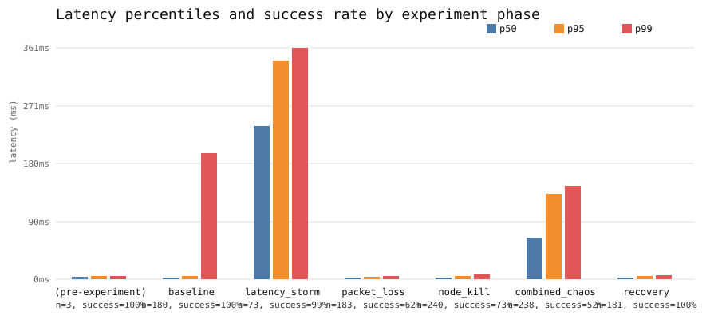
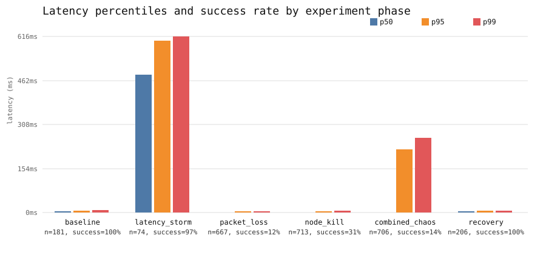

# Chaos experiment: idemq under network + process-kill chaos

## Enqueue (producer) latency and success rate by phase

| Phase | Requests | Success Rate | p50 | p95 | p99 | Failures | Ambiguous |
|---|---:|---:|---:|---:|---:|---:|---:|
| (pre-experiment) | 3 | 100.0% | 4ms | 5ms | 5ms | 0 | 0 |
| baseline | 180 | 100.0% | 3ms | 5ms | 197ms | 0 | 0 |
| latency_storm | 73 | 98.6% | 239ms | 342ms | 361ms | 0 | 1 |
| packet_loss | 183 | 61.7% | 2ms | 4ms | 5ms | 0 | 70 |
| node_kill | 240 | 72.9% | 2ms | 5ms | 7ms | 0 | 65 |
| combined_chaos | 238 | 51.7% | 65ms | 133ms | 146ms | 0 | 115 |
| recovery | 181 | 100.0% | 3ms | 5ms | 6ms | 0 | 0 |

## Claim+Ack (consumer) latency and success rate by phase

| Phase | Requests | Success Rate | p50 | p95 | p99 | Failures | Ambiguous |
|---|---:|---:|---:|---:|---:|---:|---:|
| baseline | 181 | 100.0% | 4ms | 6ms | 8ms | 0 | 0 |
| latency_storm | 74 | 97.3% | 482ms | 603ms | 616ms | 0 | 2 |
| packet_loss | 667 | 12.3% | 1ms | 4ms | 5ms | 0 | 585 |
| node_kill | 713 | 30.7% | 1ms | 5ms | 7ms | 0 | 494 |
| combined_chaos | 706 | 14.4% | 1ms | 223ms | 261ms | 0 | 604 |
| recovery | 206 | 100.0% | 4ms | 6ms | 8ms | 0 | 0 |

## Notes

Reconciliation (n=1098 idempotency keys used): completed=1098, still pending=0, dead-lettered=0, status-lookup-failed=0, unresolvable-key=0.

No job's idempotency key ever resolved to more than one distinct job ID, and no job was ever lost — every job is accounted for in exactly one of these terminal/pending states.
